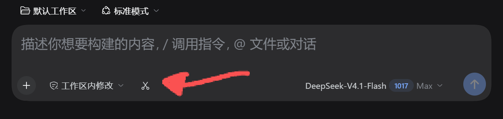

# dsh-Print Screen

[中文](README.md) | English

`dsh-print-screen` adds one scissors button to the DSH composer. Click it and the whole virtual desktop (every monitor) freezes at its original position and pixel size; drag a rectangle on that frozen image, release, and the crop is inserted into the prompt as an image attachment. The shot is stored once, in the DSH attachment library under a content hash, and is not copied into the workspace. Windows only.

```text
composer, bottom left:  [+]  [✂]  [workspace edits]  [Plan]
                           │
                           └─ click ✂ → screen freezes (same place, same size) → drag → release → thumbnail lands in the composer
```



## Features

- **One scissors button.** Same as any other composer button: transparent background, icon only, no extra width.
- **Freeze first, then drag.** The entire virtual desktop (all monitors) is frozen, each screen keeping its original position and pixel size; releasing the mouse crops it and inserts the result.
- **DSH hidden by default.** The DSH window is hidden before the shot and restored right after it (maximized state included), so windows it was covering can be captured.
- **Two ways to keep it visible.** Hold `Shift` while clicking, or press `Ctrl+Shift+Alt+1`.
- **Inserted into the composer.** The shot goes through the session's own attachment API, so the thumbnail appears under the input and is sent with the message on Enter. If that fails it falls back to a synthetic paste event, and finally to the clipboard with a `Ctrl+V` hint.
- **Timestamped filenames.** Attachments are named `screenshot-2026-10-26_22-31-05.png` (local time, second precision), so several shots never collide.
- **One copy, no duplication.** The image is stored once in the DSH attachment library (`~/.dsh/attachments`), named by its content hash; no copy is written into the workspace, and uploading the same image twice still stores only one object.
- **Indexed per session.** After each shot the host appends `{time, filename, hash, size, session id/title, object path}` to `screenshots.json` in the session directory, which answers "which conversation does this image belong to". Failing to write it never affects the shot.
- **Optional extra backup.** Set `SAVE_TO_SESSION` to `true` in `client.js` to also write a same-named PNG into the session folder (costs double the disk per shot).

## Controls

| Action | Behavior |
|---|---|
| Click the scissors | Capture, hiding the DSH window first |
| `Shift` + click | Capture without hiding DSH (it can be in the shot) |
| `Ctrl+Alt+1` | Same as a click: capture with DSH hidden |
| `Ctrl+Shift+Alt+1` | Capture with DSH visible |
| Drag a rectangle, release | Crop, insert into the composer, and append a line to `screenshots.json` (DSH is restored as soon as the crop returns) |
| `Esc` / right-click | Cancel |

> Hotkeys match physical keys (`event.code`), so they also fire on layouts where `Shift+1` produces `!`; `!` itself is not handled.

## Speed

Each capture no longer spawns a fresh `powershell.exe` (about 1.2 s of process start plus assembly load, and antivirus scans it again). Instead, 2.5 s after DSH starts — deliberately past the startup spike — the host launches a **persistent screenshot helper**, `helper.ps1`, so WinForms, DPI, P/Invoke and the bitmap buffer are initialized once. After that a capture costs:

| Stage | Measured |
|---|---|
| Helper start (once per DSH start, in the background) | ~1.4 s |
| Click → frozen desktop visible (warm) | ~0.15 s (with the window's DWM transitions disabled, `SW_HIDE` is immediate and only 30 ms is awaited; the frame is blitted straight in, first paint ~40 ms) |
| First request (includes the first-paint JIT) | ~0.3 s |
| Drag → cropped image returned | ~0.02 s to save, plus transfer and insertion |

The capture path is `BitBlt` straight into a persistent DIB (30–40 ms faster than GDI+ `CopyFromScreen` per screen); hiding uses `SW_HIDE`, which is immediate, where `SW_MINIMIZE` costs a 150–250 ms animation; window, fonts, pens and bitmap buffers are reused across requests. There is only one implementation, `helper.ps1`.

If the helper cannot start or dies mid-request, the host restarts it and retries rather than maintaining a second screenshot script.

## Requirements

| | |
|---|---|
| DSH | `>= 0.2.1-rc.3` (`engines.dsh`) |
| OS | **Windows only** (10/11, using the built-in Windows PowerShell 5.1 and System.Drawing/WinForms) |
| Other | No native Node modules, no external service, no API key |

## Install

```sh
# from npm
dsh plugin --profile web add dsh-print-screen

# or from GitHub source
dsh plugin --profile web add github:zrrrrrrr77/dsh-print-screen
```

You can also open **Plugins → Discover** in DSH and install it from the plugin market.

After installing, the scissors sits at the left of the composer, just before "workspace edits". If it is missing, refresh the page; if it is still missing, quit DSH completely and start it again, because the host half only loads on restart.

> Replace `web` in `dsh plugin --profile web` with your own profile name. A desktop build manages its profile itself, so install from the plugin page inside the app instead.

## How it works

- **DPI is the whole game.** The capture script must declare **Per-Monitor V2 DPI awareness**. Without it Windows virtualizes the process at 250% and the frozen image is scaled up 2.5x — which users see as "the screen got bigger", not a 1:1 copy. With it every coordinate is a physical pixel and the display matches the mouse exactly.
- Captures `BitBlt` each screen straight into a persistent DIB (30–40 ms faster than GDI+ `CopyFromScreen`), rebuilding the buffer only when the screen size changes. The freeze window also blits the DIB into its device context inside `Paint` instead of using `BackgroundImage`, whose first full-screen paint takes ~500 ms and visibly stalls the drag.
- Before hiding, the host calls `DwmSetWindowAttribute(hwnd, DWMWA_TRANSITIONS_FORCEDISABLED, TRUE)` to disable DWM transitions for that window, which makes `SW_HIDE` immediate; it then waits **30 ms** for the compositor to produce a frame before capturing (without that the window fades out over ~200 ms and a 40 ms capture still contains a translucent ghost). Target windows are the union of two signals: every visible top-level window whose **process name** is `DeepSeek Harness`, and every window whose **title ends with** `DeepSeek Harness` — in practice the DSH main window's host process is not necessarily named that, and matching by process name alone finds nothing, leaving DSH inside the frozen frame. After the shot each window is restored to its previous state with `SW_SHOW` or `SW_SHOWMAXIMIZED`.
- After hiding, the helper checks again: if a target window is still visible (hiding did not take effect), its rectangle is painted out of the frozen frame, so DSH can never appear in the screenshot.
- The hidden/restored window list is passed in as an `ArrayList` parameter (`Get-TargetWindows -Into`) instead of being returned — PowerShell unrolls a single-element collection into a bare object, which silently broke the whole restore path whenever only the main window matched (the symptom: DSH stayed in the taskbar after a shot and had to be clicked back). After restoring, `SwitchToThisWindow` plus `SetForegroundWindow` bring the main window forward.
- The selection region is **not dimmed and has no shadow**: it is outlined with a crisp two-tone border (black outside, blue inside) so the edges stay visible on any background.
- The DSH desktop host is a separate Node process without `desktopCapturer`, and the renderer is isolated by `contextIsolation` with display media disabled, so "freeze and drag" is done by `helper.ps1`, which ships in this package.
- Insertion has three channels: `ctx.get('conversation').createDrafts()` + `inputActions.addAttachments()`, then a synthetic Lexical `paste` event, then the clipboard.
- Saving: the crop is finished in a temporary directory, then the host copies it into the session directory using the `session.cwd` sent by the client and a timestamped name (exclusive `wx` create, `-1` on collision); the `X-Screenshot-Saved` response header carries the path back to the front end.

## Privacy and security

- Screenshots **stay on this machine**: the host runs `powershell.exe` with a full-screen WinForms window and the image lives in memory; the chosen crop is handed to the DSH attachment library, and the temporary file used for transfer is deleted as soon as the browser has read it. The plugin makes no network requests.
- The plugin runs `powershell.exe -File helper.ps1 -ExecutionPolicy Bypass` with your user privileges (the script ships in the package and can be reviewed). It only hides and restores windows whose process name or title matches DSH; nothing else is touched.
- Insertion reuses DSH's own attachment path, so a shot travels exactly the same upload and save route as a pasted image.
- **Only three local traces exist**: the image object in the attachment library; `screenshots.json` in the session directory (filename, hash, size, session title — it answers "which conversation owns this shot"); and `%TEMP%\dsh-print-screen-helper.log`, which records timings, the number of hidden windows and **title lengths only** — never the titles themselves.
- **The diagnostic dump is off by default.** Only with `DSH_SCREENSHOT_FRAME_DUMP=1` set does a *cancelled* capture write the whole frozen frame to `%TEMP%\dsh-print-screen-last-frame.png`, to check whether DSH ended up in the picture.
- **A sent screenshot does leave the machine**: as a message attachment it goes to the model provider along with the conversation. That is DSH's own behaviour, not a network call made by this plugin.

## Self-test

```sh
node test.mjs          # route registration, cross-site rejection, one real capture (-SelfTest, fixed crop, no window)
node test-client.mjs   # button structure, Shift / Ctrl+Alt+1 detection, timestamped filenames
node test-route.mjs    # integration: real route + persistent helper + simulated drag, cold/warm latency
node --check client.js
node --check index.js
```

```powershell
powershell -ExecutionPolicy Bypass -File test-helper.ps1   # helper: startup cost, warm latency, simulated drag
powershell -ExecutionPolicy Bypass -File test-hide.ps1     # hide/restore check against a stand-in window
```

The helper protocol has a self-test mode (sixth field `1`: no window, fixed 320x200 crop); that is what `node test.mjs` uses.

## Known limitations

- Windows only.
- The freeze overlay is an ordinary top-most window, so in theory another top-most window can cover a corner of it.
- DSH is hidden while you capture; if the helper ever hangs (it is killed after a 5-minute timeout), DSH has to be restored by hand.
- **Never delete images from the attachment library by hand.** Messages reference them by hash, so removing an object makes the sessions that reference it fail and their images disappear. Use the "Delete Conversation" plugin so images are removed together with the conversation.

## License

MIT
